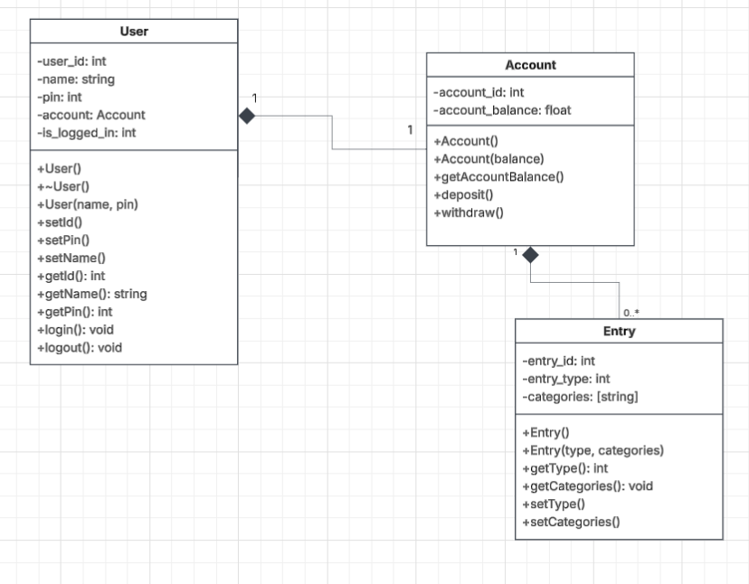

# Standup Minutes:

**Date and time:** 05-11-2026

**Facilitator:** Sofia

**Note taker:** Sofia

**Attendees:** Sofia, Luke

**Absent:** N/A

## Agenda

- Create a draft for UML classes

## Discussion Notes

- Main Application layer will depend on commands that are presented at the start
- To view commands at any point type eg. 'help', similar to a command line prompt.

## Project Board

| Task     | Assignee | Details                        |
| :------- | :------- | :----------------------------- |
| [KAN-30] | [SL]     | Upload minutes                 |
| [KAN-26] | [LK]     | 'User' class implementation    |
| [KAN-28] | [SL]     | 'Account' class implementation |
| [KAN-27] | [SL]     | 'Entry' class implementation   |

## Parking lot

N/A

## Next meeting

- Project Timeline (and weekly goals)
- User Flow Chart

**Date:** 11-11-2026
